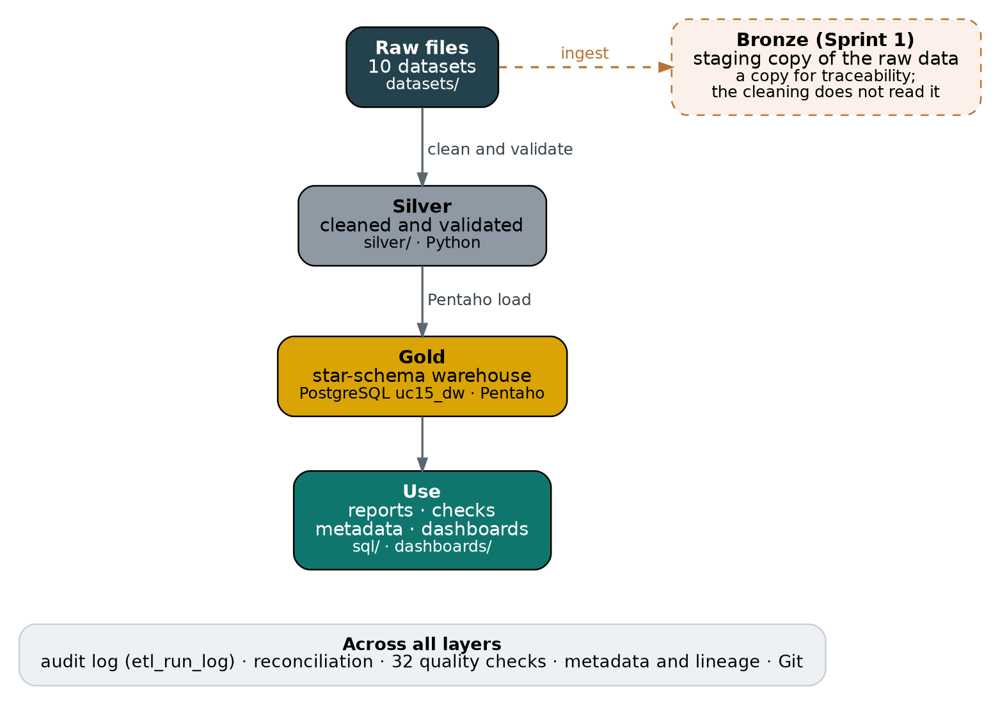
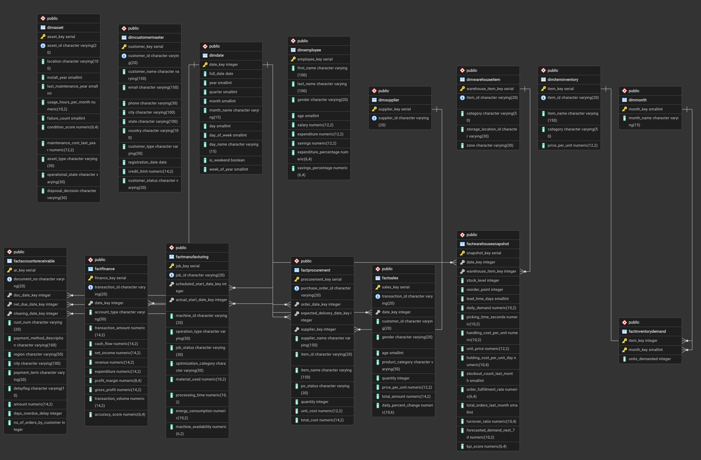

# Enterprise Resource Planning Data Platform (ERPDP)
### Project Report: Sprints 0 to 3

**ABC Global Enterprises Ltd.**  
UC15 project team  
Repository: github.com/7-Kaviya/Data-Engineering-UC15  
Date: 16 October 2026

---

## Contents

1. Executive summary
2. Business context and objectives
3. Solution architecture
4. Data sources
5. How the work was done, sprint by sprint
6. Results
7. Data quality findings
8. Challenges and how we solved them
9. Limitations and future work
10. Conclusion
11. Appendix: deliverables by sprint

---

## 1. Executive summary

This project builds an Enterprise Resource Planning Data Platform (ERPDP) for ABC Global Enterprises Ltd. The platform collects data from 10 ERP datasets in five file formats, cleans and checks it, and stores it in a PostgreSQL data warehouse that is ready for reporting. It was built in four sprints with Pentaho Data Integration, PostgreSQL, Python and Git.

| Measure | Result |
|---|---|
| Source datasets | 10 datasets (CSV, Excel, JSON, XML and SQL files) from the finance, procurement, sales, inventory, manufacturing, HR, warehouse, asset, customer and receivables areas |
| Data warehouse | 15 tables (8 dimensions and 7 facts), 141 columns, 78,558 rows, in a star schema design |
| Loading | One Pentaho job runs from the raw files to a reconciled warehouse in about 7 seconds, and writes an audit log |
| Reconciliation | 15 of 15 tables match their control totals. For the 10 datasets, raw file, cleaned file and warehouse agree for 9, and for the tenth after removing 3,204 duplicate rows |
| Data quality checks | 32 checks on the finished warehouse: 21 PASS, 11 KNOWN ISSUE (documented problems in the source data), 0 UNEXPECTED |
| Data quality findings | 12 findings documented in the Data Quality Report |
| Governance | Source-to-target mapping of all 141 columns, metadata repository, business glossary of 79 terms, data lineage document and diagram |
| Analytics | 23 reporting queries; two Tableau dashboards with 10 sheets; a nine-page dashboard design with a tested data layer |
| Real-time ingestion | Live prices read from a public REST API every 5 seconds: 346 readings in about 16 minutes, with no errors |

**The most important finding.** The ten datasets do not connect to each other. Customer, item and supplier IDs differ between modules, and each module covers different years. The warehouse is therefore a set of independent star schemas that share only a calendar table, and the data cannot answer questions that cross modules, for example profit per customer. We documented this instead of inventing links between the datasets.

## 2. Business context and objectives

## 2.1 Background

ABC Global Enterprises Ltd. runs its operations through an ERP system with separate modules for finance, procurement, sales, inventory, manufacturing, human resources, warehouse, assets and customers. The modules work independently, so there is no single trusted place for enterprise reporting. Sample academic data is used in place of a live ERP connection.

## 2.2 Objectives

The Business Requirement Document asks for a platform that:

- collects business data from multiple ERP modules,
- cleans, validates and standardises transactional and master data,
- stores curated data in an enterprise PostgreSQL data warehouse,
- maintains metadata, audit logs and end-to-end data lineage,
- supports enterprise operations, analytics, financial reporting and executive dashboards,
- uses Git and GitHub for collaborative version control,
- produces enterprise-standard documentation and sprint deliverables.

## 2.3 Scope

In scope: ingestion of CSV, Excel, JSON, XML and SQL sources into PostgreSQL, profiling and cleaning, a star-schema warehouse, reports and executive dashboards. Out of scope in the original BRD: real-time streaming, replacing the ERP, and mobile apps. Real-time ingestion was added during Sprint 2, and after the review a version that reads a REST API was added at the professor's request (Section 5.3). The REST API version runs as a separate demo and is not part of the warehouse.

## 2.4 Stakeholders

| Stakeholder | Interest |
|---|---|
| CFO / Finance Head | Consolidated financial reporting |
| Procurement Manager | Vendor and spend visibility |
| Sales Director | Revenue and customer analytics |
| Warehouse / Inventory Manager | Stock accuracy |
| HR Head | Workforce reporting |
| IT / Data Engineering Team | Builds and maintains the platform |
| Executive Leadership | Cross-functional dashboards |

## 2.5 Way of working

The team followed Agile Scrum with four sprints and kept all code and documents in one GitHub repository, with a commit after each completed piece of work.

| Sprint | Focus | Main results |
|---|---|---|
| 0 | Project initiation and architecture | BRD, project charter, architecture, product backlog, repository structure |
| 1 | Data discovery and ingestion | Source inventory, data dictionary, 11 ingestion transformations, PostgreSQL staging |
| 2 | Data profiling and warehouse | Profiling, cleaning, validation, quality report, star schema, warehouse load, reporting queries, reconciliation, real-time exercise |
| 3 | Governance, lineage and analytics | Load jobs and audit log, mapping, metadata, glossary, lineage, validation report, quality checks, dashboard design |

## 3. Solution architecture

Data moves in one direction, from raw files to reports, through the layers of a medallion design.

| Layer | What it holds | Where | Built with |
|---|---|---|---|
| Raw | The 10 source files, never changed | `datasets/` | Source systems |
| Bronze | Sprint 1 copy of the raw data in staging tables, kept for traceability | `bronze/`, staging database | Pentaho ingestion |
| Silver | Cleaned and validated files, and generated reference data (calendar, months) | `silver/` | Python and pandas |
| Gold | The star-schema warehouse used for reporting | PostgreSQL database `uc15_dw` | Pentaho jobs and transformations |
| Use | Reporting queries, reconciliation, metadata views, dashboards | `sql/`, `dashboards/` | SQL, Tableau |

*Figure 1. The layers of the platform*

The route of every single dataset, from its raw file to its warehouse tables, is drawn in `lineage/Lineage_Diagram.png` and explained in `lineage/Data_Lineage.md`.

## 3.1 Design decisions

- **Independent star schemas.** Because the IDs and periods of the modules do not match, each module has its own fact table and dimensions. Only the calendar dimension is shared.
- **Surrogate keys.** Each dimension has a database-generated key, so the source IDs, which change between modules, do not drive the design.
- **Full reload.** The job empties and reloads all 15 tables on every run. This is simple and safe for this data size, and every run ends with a reconciliation.
- **Control totals.** Each load is compared with row counts and totals calculated from the cleaned files, so a failed or partial load is caught immediately.
- **No hidden fixes.** Problems in the source data are documented and flagged, not corrected, because correcting them would mean inventing values.
- **Reproducible runs.** The Pentaho files use relative paths and read the database password from a variable, so the project runs on any machine.

## 4. Data sources

| Dataset | Format | Raw file | Rows (raw to cleaned) | Warehouse tables |
|---|---|---|---|---|
| Sales | CSV | Sales_data.csv | 1,000 to 1,000 | FactSales |
| Customer Master | JSON | Customer_Master.json | 1,500 to 1,500 | DimCustomerMaster |
| Asset | XML | Asset_data.xml | 1,245 to 1,245 | DimAsset |
| Account (receivables) | Excel | Account_data.xls | 45,839 to 45,839 | FactAccountsReceivable |
| Procurement | CSV | procurement_all.csv | 1,300 to 1,300 | DimSupplier, FactProcurement |
| Employee | Excel | employee_data.xls | 35 to 35 | DimEmployee |
| Finance | CSV | Finance_data.csv | 1,000 to 1,000 | FactFinance |
| Inventory | JSON | Inventory_data.json | 1,000 to 1,000 | DimItemInventory, FactInventoryDemand |
| Manufacturing | XML | Manufacturing_data.xml | 1,000 to 1,000 | FactManufacturing |
| Warehouse | CSV | warehouse.csv | 6,408 to 3,204 | DimWarehouseItem, FactWarehouseSnapshot |

The Warehouse file holds every record twice, so cleaning removes 3,204 exact duplicates. A separate combined file also exists. It is not one of the official datasets and is not loaded into the warehouse (Finding 8).

## 5. How the work was done, sprint by sprint

## 5.1 Sprint 0: initiation and architecture

We wrote the Business Requirement Document, the project charter, the high-level architecture and a product backlog of user stories, and created the GitHub repository with a folder for each layer and each kind of deliverable.

## 5.2 Sprint 1: discovery and ingestion

We listed the sources in a source inventory, documented every field in a data dictionary, and built 11 Pentaho ingestion transformations: one for each of the 10 datasets plus the combined file. They read CSV, Excel, JSON, XML and SQL sources, load them into PostgreSQL staging tables with minimal changes, and log load errors. A copy of each staging table is kept in `bronze/staging/`.

## 5.3 Sprint 2: profiling and the warehouse

### Profiling

Two Jupyter notebooks profile the ten datasets, five in each. The Data Profiling Report summarises, for every dataset, its size, column types, missing values, duplicates, key uniqueness, date ranges and value distributions.

### Cleaning

Two Python scripts, five datasets each, standardise column names, convert types and dates, remove blank rows and remove exact duplicates, and write the cleaned files to `silver/cleansing/cleaned_datasets/`. Sales dates are converted from day-month-year to year-month-day. The only rows removed are the 3,204 duplicates in the Warehouse file.

### Validation

Two validation scripts test the cleaned files with 81 checks in total. 76 pass and 5 fail, and all 5 failures are real properties of the source data that the Data Quality Report documents: the 258 empty manufacturing values (the 129 failed jobs), one empty sales value, customers registered in the future, and the receivables dates that are out of order.

### Star schema

The warehouse has 8 dimension tables and 7 fact tables. The table definitions are in `sql/01_create_star_schema.sql`, and the entity relationship diagram was exported from pgAdmin.

*Figure 2. Entity relationship diagram of the warehouse (uc15_dw)*

### Loading the warehouse

Fifteen Pentaho transformations load the tables in four groups: plain dimensions; reference and complex dimensions (the calendar, months, suppliers and customers, whose contact and address JSON is split into columns); facts with date keys; and facts that look up dimension keys. The inventory transformation turns the 12 monthly demand columns into 12 rows per item. A Python loader (`python/03_load_star_schema.py`) gives the same result and was used as a cross-check.

### Reporting queries and reconciliation

`sql/04_enterprise_reporting_queries.sql` holds 23 queries on sales, procurement, inventory, warehouse, finance and manufacturing, including one that compares sales and procurement by month. `sql/05_reconciliation_checks.sql` compares every table with control totals from the cleaned files, and all 15 tables match.

### Real-time ingestion

Two versions were built. The first lives inside the project: a producer writes simulated sales events into a queue table and a consumer, notified through PostgreSQL's LISTEN and NOTIFY, validates each event and loads it into a real-time fact table. Events arrived in 1 to 6 milliseconds, and invalid events were rejected with a reason. Its two extra tables (`sql/06_realtime_setup.sql`) are optional and are not among the 15 warehouse tables.

The second, added after the Sprint 2 review, uses a real external source. `realtime_rest_demo/ingest_rest_api.py` reads live BTC-USD and ETH-USD prices from the public Coinbase API every 5 seconds, validates each reading and stores it in its own database. A run of about 16 minutes stored 346 readings with an average API response time of 382 milliseconds and no problems logged. Queries on the stored data derive the change since the first reading, one-minute candles (open, high, low, close), a moving average, volatility and the largest jumps.

## 5.4 Sprint 3: governance, lineage and analytics

### Load jobs and the audit log

The Pentaho job `ETL_Load_Warehouse` resets the tables, loads the 8 dimensions and then the 7 facts, logs the row count of every table, reconciles the result and stops with a FAILED entry if anything goes wrong. Every stage is written to the table `etl_run_log`.

The job `ETL_End_To_End` starts earlier. It runs the two cleaning scripts and the two validation scripts, calls the load job, runs the layer reconciliation and then a data quality gate. On the project laptop the whole run, from raw files to a reconciled warehouse, took about 7 seconds. We tested both failure paths: a failing script, and data that breaks a business rule which the totals cannot see. In both cases the job logged FAILED and stopped.

### Metadata, glossary and mapping

`metadata/Source_to_Target_Mapping.xlsx` traces all 141 warehouse columns back to the raw file, the cleaned file and the Pentaho rule that loads them. `metadata/Metadata_Repository.xlsx` describes every table and column with its meaning, observed values and known issues. The same descriptions are stored inside PostgreSQL as comments, with two views to list them. `metadata/ERP_Business_Glossary.xlsx` defines 79 business and data terms in plain language.

### Data lineage

`lineage/Data_Lineage.md` shows the route of each dataset, traces three columns from start to finish, lists which reporting queries read each table, and says what to re-run if a source changes. Writing it revealed differences between the Sprint 1 source inventory and the files (Section 9).

### Enterprise-wide reconciliation and quality checks

A Python script compares the raw file, the cleaned file and the warehouse for every dataset, using a row count and one control total. `sql/10_data_quality_checks.sql` adds 32 checks on the finished warehouse. They test keys and foreign keys, business rules that should hold, and the known problems of the source data against the numbers documented in the Data Quality Report. We proved the checks can fail by changing values on purpose and rolling the change back.

### Dashboard design

`sql/11_dashboard_views.sql` creates 11 flat views, one per dashboard area, without names, e-mail addresses or phone numbers. They are exported to CSV files and checked: every view has the same number of rows as its table, and every total equals the warehouse control total. `dashboards/Dashboard_Design.md` defines nine pages, the measures for each, and the numbers every page should show.

### Tableau dashboards

`dashboards/Dashboards.twbx` is a Tableau workbook built on the exported dashboard data. It has 10 sheets on 2 dashboards: sales by category, warehouse demand, receivable delays, procurement cost, finance revenue, machine availability, inventory demand by month, salary by age group, credit limit by city, and asset condition. The Business Requirement Document named Power BI as the reporting tool, and the dashboards were built in Tableau instead. The same views and design also support a Power BI build (`dashboards/Power_BI_Build_Guide.md`). The category totals, the monthly demand and the city credit limits that we compared with the warehouse match. `dashboards/Tableau_Dashboard_Notes.md` lists what each sheet shows and the improvements that are still open.

### Reproducibility

The end-to-end job re-runs the cleaning scripts, so we tested whether they reproduce the committed files. Nine of the ten cleaned files were identical byte for byte, and Finance differed only in the 16th or 17th digit of 22 numbers. The test also found a real problem: the date conversion in the second cleaning script silently did nothing with the newest version of pandas, which left the Sales dates unreadable for the load. A two-line fix solved it, and all 1,000 Sales dates were checked against the raw file.

## 6. Results

## 6.1 The warehouse

| Table | Type | Rows | Columns |
|---|---|---|---|
| DimMonth | Dimension | 12 | 2 |
| DimDate | Dimension | 6,209 | 11 |
| DimEmployee | Dimension | 35 | 10 |
| DimAsset | Dimension | 1,245 | 12 |
| DimSupplier | Dimension | 10 | 2 |
| DimCustomerMaster | Dimension | 1,500 | 12 |
| DimItemInventory | Dimension | 1,000 | 5 |
| DimWarehouseItem | Dimension | 3,204 | 5 |
| FactSales | Fact | 1,000 | 11 |
| FactFinance | Fact | 1,000 | 13 |
| FactManufacturing | Fact | 1,000 | 12 |
| FactAccountsReceivable | Fact | 45,839 | 14 |
| FactProcurement | Fact | 1,300 | 12 |
| FactWarehouseSnapshot | Fact | 3,204 | 17 |
| FactInventoryDemand | Fact | 12,000 | 3 |
| Total |  | 78,558 | 141 |

## 6.2 Reconciliation from raw file to warehouse

| Dataset | Raw rows | Cleaned rows | Loaded rows | Result |
|---|---|---|---|---|
| Sales | 1,000 | 1,000 | 1,000 | PASS |
| Customer Master | 1,500 | 1,500 | 1,500 | PASS |
| Asset | 1,245 | 1,245 | 1,245 | PASS |
| Account | 45,839 | 45,839 | 45,839 | PASS |
| Procurement | 1,300 | 1,300 | 1,300 | PASS |
| Employee | 35 | 35 | 35 | PASS |
| Finance | 1,000 | 1,000 | 1,000 | PASS |
| Inventory | 1,000 | 1,000 | 1,000 | PASS |
| Manufacturing | 1,000 | 1,000 | 1,000 | PASS |
| Warehouse | 6,408 | 3,204 | 3,204 | EXPLAINED |

Nine datasets have the same rows and totals at all three layers. Warehouse matches after the 3,204 duplicate rows are removed, and its raw total is exactly double the cleaned one.

## 6.3 Data quality checks

Of the 32 checks, 21 pass and 11 are known issues, and none is unexpected. The 11 known issues are the problems of the source data:

| Check | What it measures | Found | Finding |
|---|---|---|---|
| K01 | Receivables: due date before the document date | 11,269 | Finding 9 |
| K02 | Receivables: clearing date before the document date | 12,104 | Finding 9 |
| K03 | Receivables: days_overdue_delay differs from clearing date minus due date | 16,910 | Finding 9 |
| K04 | Receivables: delayflag disagrees with days_overdue_delay above 0 | 5,797 | Finding 9 |
| K05 | Finance: net_income differs from revenue - expenditure | 1,000 | Finding 12 |
| K06 | Finance: gross_profit differs from revenue - expenditure | 1,000 | Finding 12 |
| K07 | Finance: profit_margin differs from net_income / revenue | 998 | Finding 12 |
| K08 | Customers registered after today (changes with the date) | 42 | Finding 10 |
| K09 | Sales: empty daily_percent_change | 1 | Finding 10 |
| K10 | Procurement: orders with status Cancelled | 330 | Finding 11 |
| K11 | Procurement: suppliers that appear under more than one name | 10 | Finding 4 |

## 6.4 What the data shows

1. Sales are spread fairly evenly over Electronics, Clothing and Beauty, and female customers account for 51.1% of the revenue.
2. A quarter of the ordered procurement value (25.1%, from 330 of 1,300 orders) was cancelled. Without the cancelled orders, spend is about 735 million, and supplier SUP004 is the largest.
3. 65.7% of receivable documents are flagged as delayed, but 30.5% have dates that contradict each other, so lateness is only indicative.
4. Grocery is 84.5% of inventory demand, and demand barely changes through the year (March is 1.2% above August).
5. 237 warehouse items (7.4%) are below their reorder point, and Zone D had the most stockouts last month.
6. Machines M04 and M03 fail 17.6% and 15.6% of their jobs, against 10.0% to 10.9% for the other three.
7. 67.6% of the 1,245 assets are obsolete, and Recycle is the most common planned disposal.
8. Tamil Nadu has the most customers (379, or 25.3%), and 92.9% of all customers are active.

The datasets are synthetic, so these results describe the data we have and not a real company.

## 7. Data quality findings

The Data Quality Report documents 12 findings. The table shows how each one affected the design.

| # | Finding | How it was handled |
|---|---|---|
| 1 | Customer IDs are different in Sales, Customer Master and Account | No link between Sales, Customer Master and Receivables; customer IDs kept as plain columns |
| 2 | Item IDs are different across Inventory, Warehouse, Procurement and Sales | Two separate item dimensions (Inventory and Warehouse) |
| 3 | The dates of the modules are in different years | Modules are analysed one by one; the calendar spans 2011 to 2027 |
| 4 | Supplier names change for the same supplier ID | The supplier dimension keeps the ID only; the name stays on the order |
| 5 | Finance cannot be linked to Sales or Procurement | Finance is a standalone fact table |
| 6 | 129 manufacturing jobs have no actual start and end | The empty actual start is exactly the Failed jobs; the column allows empty values |
| 7 | Employee has no ID column | Employees get a generated key only |
| 8 | The combined dataset is not the same as the official datasets | The combined file is excluded from the warehouse and used only for cross-checks |
| 9 | Dates in the Account (Accounts Receivable) data are not logical | Kept and flagged; lateness figures are indicative only |
| 10 | Smaller issues in Customer and Sales | Kept as given; one value may be empty |
| 11 | Cancelled purchase orders carry a quarter of the procurement cost | Spend reports leave out cancelled orders |
| 12 | The finance measures do not add up | Kept as given; one finance measure is never recomputed from another |

## 8. Challenges and how we solved them

| Challenge | What we did |
|---|---|
| The PostgreSQL password was lost | We switched the access file `pg_hba.conf` to trust mode for a moment, set a new password, restored password checking and recreated the pgAdmin connection. |
| The modules do not connect | We built independent star schemas and documented the missing links as findings, instead of forcing joins that the data cannot support. |
| Absolute file paths broke when the project moved between computers | The 15 load transformations use paths relative to the file and a password variable. The Sprint 1 ingestion files still use fixed paths and are noted as machine-specific. |
| We needed proof that no data was lost | We compared control totals at three levels (raw, cleaned, warehouse), added a reconciliation to every load, and built 32 checks that fail if anything changes unexpectedly. |
| A date conversion failed silently with a newer pandas | The reproducibility test found it. We fixed two lines in the cleaning script and re-checked every Sales date. |
| Spoon could not find Python for the shell steps | Spoon is started from a Terminal window, which gives it the right path to Python. |
| Red ERROR lines appeared in the Spoon log | They are pandas warnings sent to the error stream. They do not stop the job, and the setup notes explain this. |

## 9. Limitations and future work

## 9.1 Limitations

- **The Tableau dashboards are simpler than the design.** They have 10 sheets on 2 dashboards, without caveat text boxes or a data-trust page. Two sheets still need a correction: the procurement cost includes cancelled orders (Finding 11), and the asset condition score is added up instead of averaged. The delay days and the finance revenue are shown without their warnings (Findings 9 and 12).
- **Modules cannot be combined.** Customer, item and supplier IDs and the years differ, so cross-module analysis such as profit per customer is not possible with this data.
- **Some measures are not reliable.** The receivables delay columns and the finance measures do not follow the usual formulas (Findings 9 and 12), and some finance dates are in the future.
- **Bronze and Silver are not linked in the code.** The cleaning scripts read the raw files directly, not the Bronze copy. The Sprint 1 source inventory also differs from the files for Employee (1,500 rows listed, 35 in the file), Procurement (the SQL file is listed, the CSV file is used) and Account (45,856 rows listed, 45,839 in the file).
- **Full reload only.** The warehouse is emptied and reloaded on every run. This suits the data size but not a large system.
- **The data is synthetic.** Conclusions about the business are illustrations, not facts about a company.

## 9.2 Future work

- Improve the Tableau dashboards with the fixes in `dashboards/Tableau_Dashboard_Notes.md`: leave out cancelled orders, average the condition score, and add the caveat texts and a data-trust sheet.
- Agree one official procurement dataset, correct the source inventory and rebuild Bronze from the files that Silver actually uses.
- Add master data that links customers, items and suppliers across modules, so cross-module analysis becomes possible.
- Move to incremental loads, and run the end-to-end job on a schedule with alerts on failure.
- Add a Finding 13 for the finance transactions dated after today, and a check for it.

## 10. Conclusion

The project delivers what the Business Requirement Document asked for. Data from ten ERP datasets is collected, cleaned, validated and loaded into a PostgreSQL star-schema warehouse by one repeatable job, with an audit log, a mapping to the sources, metadata, a glossary, lineage documentation and a set of checks that prove the load is complete. The most valuable result is not only the warehouse but the evidence around it: every number can be traced to a source file, and every known problem of the source data is documented and monitored. The main limit is the data itself, which is synthetic and disconnected between modules. The remaining work is to bring the Tableau dashboards closer to the dashboard design, and the follow-up items in Section 9.

## Appendix: deliverables by sprint

| Sprint | Deliverable | Location |
|---|---|---|
| 0 | BRD, charter, architecture, product backlog | `docs/` |
| 1 | Source inventory and data dictionary | `docs/Source_Inventory.xlsx`, `bronze/ingestion/` |
| 1 | 11 ingestion transformations and staging copies | `pentaho/transformations/`, `bronze/staging/` |
| 2 | Data Profiling Report and notebooks | `docs/Data_Profiling_Report.md`, `python/` |
| 2 | Cleaning and validation scripts and results | `python/`, `silver/` |
| 2 | Data Quality Report (12 findings) | `docs/Data_Quality_Report.md` |
| 2 | Star schema, warehouse and 15 load transformations | `sql/01_create_star_schema.sql`, `pentaho/transformations/` |
| 2 | Reporting queries and reconciliation | `sql/04_enterprise_reporting_queries.sql`, `sql/05_reconciliation_checks.sql` |
| 2 | Real-time ingestion (two versions) | `realtime_rest_demo/`, `python/realtime_*.py`, `sql/06_*`, `sql/07_*` |
| 3 | Load job, end-to-end job and audit log | `pentaho/jobs/`, `sql/08_etl_audit_setup.sql` |
| 3 | Source-to-target mapping, metadata, glossary | `metadata/`, `sql/09_metadata_comments.sql` |
| 3 | Data lineage document and diagram | `lineage/` |
| 3 | Validation Report, layer reconciliation and checks | `docs/Validation_Report.md`, `python/ERP_Layer_Reconciliation.py`, `sql/10_data_quality_checks.sql` |
| 3 | Dashboard views, exported data, design and Tableau dashboards | `sql/11_dashboard_views.sql`, `dashboards/` |
| 3 | README with how to run | `README.md` |
