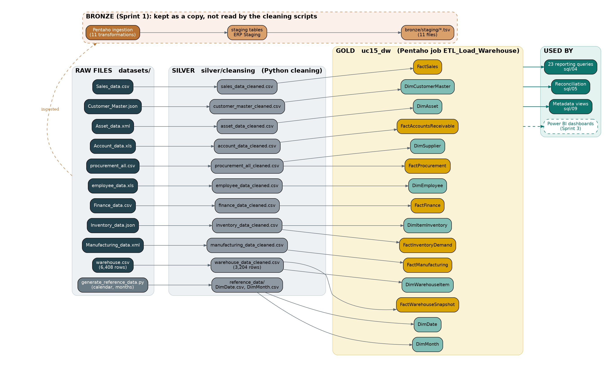

# Data Lineage

**Project:** UC15 - Enterprise Resource Planning Data Platform (ERPDP)  
**Sprint:** 3 (Governance, lineage and analytics)  
**Repository:** Data-Engineering-UC15

---

## 1. Purpose

This document shows where every table in the warehouse comes from and what happens to the data on the way: from the raw file, through cleaning and validation, to the Pentaho load and the reports that read it. It answers two questions: *where did this number come from?* and *what is affected if this source changes?*

It was written from the files and scripts in this repository, not from an automatic lineage tool. The column-by-column detail is in `metadata/Source_to_Target_Mapping.xlsx`, and the meaning of each column is in `metadata/Metadata_Repository.xlsx`.

---

## 2. The path in one picture

Reading the picture from left to right:

| Step | What happens | Tool | Folder |
|---|---|---|---|
| 1. Raw files | The 10 source datasets, never changed. | none | `datasets/` |
| 2. Cleaning | Names standardised, dates and numbers converted, blank and duplicate rows removed. | Python (`ERP_Data_Cleaning_separate1.py`, `ERP_Data_Cleaning_separate2.py`) | `silver/cleansing/cleaned_datasets/` |
| 3. Validation | Rule checks on the cleaned files, with a summary file for each group. | Python (`ERP_Data_Validation_Separate.py`, `ERP_Data_Validation_Group2.py`) | `silver/validation/` |
| 4. Reference data | The calendar and the month list are generated, not taken from a source system. | Python (`generate_reference_data.py`) | `silver/cleansing/reference_data/` |
| 5. Load | Each cleaned file is loaded into its warehouse table. | Pentaho (15 transformations, run by the job `ETL_Load_Warehouse.kjb`) | `pentaho/transformations/`, `pentaho/jobs/` |
| 6. Use | Reporting queries, the reconciliation check, the metadata views and (in Sprint 3) the Power BI dashboards. | SQL, Power BI | `sql/`, `dashboards/` |

The Bronze branch at the top of the picture is the Sprint 1 copy of the raw data. It is kept for traceability, but the cleaning scripts do not read it (see Section 8).

---

## 3. Lineage by dataset

| Dataset | Raw file (`datasets/`) | Cleaning script (`python/`) | Cleaned file | Validation script | Pentaho load | Warehouse tables | Rows: raw → cleaned → loaded |
|---|---|---|---|---|---|---|---|
| Sales | `Sales_data.csv` | `ERP_Data_Cleaning_separate2.py` | `sales_data_cleaned.csv` | `ERP_Data_Validation_Group2.py` | `Load FactSales.ktr` | FactSales | 1,000 → 1,000 → 1,000 |
| Customer Master | `Customer_Master.json` | `ERP_Data_Cleaning_separate2.py` | `customer_master_cleaned.csv` | `ERP_Data_Validation_Group2.py` | `Load DimCustomerMaster.ktr` | DimCustomerMaster | 1,500 → 1,500 → 1,500 |
| Asset | `Asset_data.xml` | `ERP_Data_Cleaning_separate2.py` | `asset_data_cleaned.csv` | `ERP_Data_Validation_Group2.py` | `Load DimAsset.ktr` | DimAsset | 1,245 → 1,245 → 1,245 |
| Account | `Account_data.xls` | `ERP_Data_Cleaning_separate2.py` | `account_data_cleaned.csv` | `ERP_Data_Validation_Group2.py` | `Load FactAccountsReceivable.ktr` | FactAccountsReceivable | 45,839 → 45,839 → 45,839 |
| Procurement | `procurement_all.csv` | `ERP_Data_Cleaning_separate2.py` | `procurement_all_cleaned.csv` | `ERP_Data_Validation_Group2.py` | `Load DimSupplier.ktr`, `Load FactProcurement.ktr` | DimSupplier, FactProcurement | 1,300 → 1,300 → 10 and 1,300 |
| Employee | `employee_data.xls` | `ERP_Data_Cleaning_separate1.py` | `employee_data_cleaned.csv` | `ERP_Data_Validation_Separate.py` | `Load DimEmployee.ktr` | DimEmployee | 35 → 35 → 35 |
| Finance | `Finance_data.csv` | `ERP_Data_Cleaning_separate1.py` | `finance_data_cleaned.csv` | `ERP_Data_Validation_Separate.py` | `Load FactFinance.ktr` | FactFinance | 1,000 → 1,000 → 1,000 |
| Inventory | `Inventory_data.json` | `ERP_Data_Cleaning_separate1.py` | `inventory_data_cleaned.csv` | `ERP_Data_Validation_Separate.py` | `Load DimItemInventory.ktr`, `Load FactInventoryDemand.ktr` | DimItemInventory, FactInventoryDemand | 1,000 → 1,000 → 1,000 and 12,000 |
| Manufacturing | `Manufacturing_data.xml` | `ERP_Data_Cleaning_separate1.py` | `manufacturing_data_cleaned.csv` | `ERP_Data_Validation_Separate.py` | `Load FactManufacturing.ktr` | FactManufacturing | 1,000 → 1,000 → 1,000 |
| Warehouse | `warehouse.csv` | `ERP_Data_Cleaning_separate1.py` | `warehouse_data_cleaned.csv` | `ERP_Data_Validation_Separate.py` | `Load DimWarehouseItem.ktr`, `Load FactWarehouseSnapshot.ktr` | DimWarehouseItem, FactWarehouseSnapshot | 6,408 → 3,204 → 3,204 and 3,204 |
| Calendar (generated) | none | `generate_reference_data.py` | `reference_data/DimDate.csv` | none | `Load DimDate.ktr` | DimDate | 6,209 |
| Month list (generated) | none | `generate_reference_data.py` | `reference_data/DimMonth.csv` | none | `Load DimMonth.ktr` | DimMonth | 12 |

The two columns of row counts that change are Warehouse (the raw file holds every record twice, so 3,204 duplicates are removed) and Inventory (each item becomes 12 rows, one per month). The combined file `erp_cleaned_data.csv` is not part of this lineage, because it is not loaded into the warehouse (Finding 8 of the Data Quality Report).

---

## 4. How a load runs

The Pentaho job `ETL_Load_Warehouse` runs the whole load in a fixed order and records each stage in the table `etl_run_log`:

1. **Log** that the job started, then **reset** all 15 warehouse tables.
2. **Dimensions first**, because the facts look up their keys: DimMonth, DimDate, DimEmployee, DimAsset, DimSupplier, DimCustomerMaster, DimItemInventory, DimWarehouseItem.
3. **Facts next**: FactSales, FactFinance, FactManufacturing, FactAccountsReceivable, FactProcurement, FactWarehouseSnapshot, FactInventoryDemand.
4. **Log the row count** of every table.
5. **Reconcile**: compare each table's row count and one total with figures calculated from the cleaned files. If they all match, log SUCCESS. If not, log FAILED and stop (Abort).

If any load step fails, the job logs FAILED and stops. The latest run can be read with `SELECT * FROM vw_etl_last_run;`.

The job `ETL_End_To_End` (`pentaho/jobs/ETL_End_To_End.kjb`) starts earlier. It first runs the two cleaning scripts and the two validation scripts, then calls `ETL_Load_Warehouse` as a sub-job, then runs `ERP_Layer_Reconciliation.py` and the data quality gate (`vw_data_quality_checks`). If any step fails it logs FAILED and stops. This is the one-click path from the raw files to a reconciled warehouse.

---

## 5. Three columns traced from start to finish

**FactSales.total_amount**

1. Raw: `datasets/Sales_data.csv`, column `Total Amount`.
2. Cleaning: the name becomes `total_amount` in `sales_data_cleaned.csv`.
3. Validation: the total equals quantity times price in all 1,000 rows (0 errors).
4. Load: `Load FactSales.ktr` copies the value as it is into `FactSales.total_amount`.
5. Use: 5 reporting queries read FactSales, and the reconciliation compares its total (456,000.00) with the cleaned file.

**FactProcurement.supplier_key**

1. Raw: `datasets/procurement_all.csv`, column `supplier_id`.
2. Cleaning: `procurement_all_cleaned.csv`, column `supplier_id`.
3. Load: `Load DimSupplier.ktr` first keeps each different `supplier_id` once (10 suppliers) and PostgreSQL gives each a `supplier_key`.
4. Load: `Load FactProcurement.ktr` then looks up each order's `supplier_id` in DimSupplier and stores that key in `FactProcurement.supplier_key`.
5. Use: the spend-by-supplier query joins the two tables on this key.

**FactInventoryDemand.units_demanded**

1. Raw: `datasets/Inventory_data.json`, columns `Jan_Demand` to `Dec_Demand`.
2. Cleaning: `inventory_data_cleaned.csv`, columns `jan_demand` to `dec_demand`.
3. Load: `Load FactInventoryDemand.ktr` turns the 12 columns into 12 rows per item (a row normaliser step) and looks up each item's `item_key` in DimItemInventory.
4. Result: 1,000 items become 12,000 rows, and the total of `units_demanded` equals the sum of the 12 source columns (16,961,896).

---

## 6. Where the warehouse data is used

The 23 reporting queries in `sql/04_enterprise_reporting_queries.sql` read these tables. Every table is also checked by `sql/05_reconciliation_checks.sql` and described in the metadata views from `sql/09_metadata_comments.sql`.

| Table | Reporting queries that read it |
|---|---|
| DimDate | 4 |
| DimMonth | 1 |
| DimEmployee | 0 |
| DimAsset | 0 |
| DimSupplier | 1 |
| DimCustomerMaster | 0 |
| DimItemInventory | 2 |
| DimWarehouseItem | 3 |
| FactSales | 5 |
| FactFinance | 2 |
| FactManufacturing | 4 |
| FactAccountsReceivable | 2 |
| FactProcurement | 5 |
| FactWarehouseSnapshot | 3 |
| FactInventoryDemand | 3 |

DimEmployee, DimAsset, DimCustomerMaster are not read by any reporting query yet. They are available for the Sprint 3 dashboards.

---

## 7. If a source changes

| If this raw file changes | These warehouse tables must be reloaded | Reporting queries affected |
|---|---|---|
| `Sales_data.csv` | FactSales | 5 of 23 |
| `Customer_Master.json` | DimCustomerMaster | 0 of 23 |
| `Asset_data.xml` | DimAsset | 0 of 23 |
| `Account_data.xls` | FactAccountsReceivable | 2 of 23 |
| `procurement_all.csv` | DimSupplier, FactProcurement | 5 of 23 |
| `employee_data.xls` | DimEmployee | 0 of 23 |
| `Finance_data.csv` | FactFinance | 2 of 23 |
| `Inventory_data.json` | DimItemInventory, FactInventoryDemand | 3 of 23 |
| `Manufacturing_data.xml` | FactManufacturing | 4 of 23 |
| `warehouse.csv` | DimWarehouseItem, FactWarehouseSnapshot | 3 of 23 |

After any change, the order is: re-run the cleaning script, re-run the validation script, then run the Pentaho job `ETL_Load_Warehouse`, which reloads everything and reconciles it. If the new data has a different number of rows, update the control totals in `sql/05_reconciliation_checks.sql` and in the job, or the reconciliation will correctly report a mismatch.

---

## 8. The Bronze branch from Sprint 1

In Sprint 1 each raw file was loaded into a staging table by a Pentaho ingestion transformation, and a copy of every staging table is kept in `bronze/staging/`.

| Ingestion transformation | Source | Staging table | File in `bronze/staging/` | Rows staged | Rows in the Silver input |
|---|---|---|---|---|---|
| Sales data ingestion | `Sales_data.csv` | sales | `sales.tsv` | 1,000 | 1,000 |
| Customer data ingestion | `Customer_Master.json` | customer_master | `customer.tsv` | 1,500 | 1,500 |
| Asset data ingestion | `Asset_data.xml` | asset | `asset.tsv` | 1,245 | 1,245 |
| Account data ingestion | `Account_data.xls` | account | `account.tsv` | 45,839 | 45,839 |
| Employee data ingestion | `employee_data.xls` | employees | `employees.tsv` | 70 (each of the 35 employees twice) | 35 |
| Finance data ingestion | `Finance_data.csv` | finance | `finance.tsv` | 1,000 | 1,000 |
| Inventory data ingestion | `Inventory_data.json` | inventory | `inventory.tsv` | 1,000 | 1,000 |
| Manufacturing data ingestion | `Manufacturing_data.xml` | manufacturing | `manufacturing.tsv` | 1,000 | 1,000 |
| Procurement data ingestion | SQL file `Procurement_Transactions.sql`, read through a table | procurement | `procurement.tsv` | 2,000 | 1,300 (a different file, `procurement_all.csv`) |
| Warehouse data ingestion | SQL file `Warehouse_data.sql`, read through a table | warehouse | `warehouse.tsv` | 3,204 | 3,204 after cleaning `warehouse.csv` |
| Combined data ingestion | files in a Downloads folder | erp_combined_data | `erp_combined_data.tsv` | not used | not loaded into the warehouse (Finding 8) |

---

## 9. Observations to confirm with the team

These are facts found while tracing the lineage. None of them breaks the warehouse, but they should be agreed and, where needed, corrected.

1. **Silver is built from the raw files, not from Bronze.** Both cleaning scripts read `datasets/`, and no script reads `bronze/staging/`. Bronze is a parallel copy kept for traceability.
2. **Procurement has two different sources.** The Sprint 1 source inventory lists `Procurement_Transactions.sql` (2,000 records, dates in 2026, columns such as `vendor_id` and `product_id`). The Silver and Gold layers use `procurement_all.csv` (1,300 records, dates in 2023 and 2024, with supplier and item names). The reports and dashboards describe the second one. The team should confirm which is the official procurement dataset.
3. **Employee row counts differ.** The source inventory lists 1,500 rows, the file `employee_data.xls` has 35, and the staging copy holds each of those 35 rows twice (70), which suggests the staging load ran twice.
4. **Account row counts differ slightly.** The source inventory lists 45,856 rows, and the file has 45,839.
5. **The Sprint 1 ingestion cannot be re-run elsewhere without edits.** Those transformations use fixed Windows paths (`C:\Users\USER\...`) and a staging database on one machine. The 15 warehouse transformations use relative paths and a password variable, so they run on any machine.
6. **Warehouse has two versions.** `warehouse.csv` holds 6,408 rows (every record twice), and `Warehouse_data.sql` holds 3,204. Both lead to 3,204 rows after cleaning.

---

## 10. Limits of this document

- It covers the 15 warehouse tables. The REST API demo (`realtime_rest_demo`) and the audit table `etl_run_log` have their own small lineage and are not part of the picture.
- The Power BI dashboards are not built yet. When they are, the dashboard pages and the tables they read should be added to Section 6.
- Row counts and query counts were measured on the loaded warehouse and on the files as they are in the repository.
